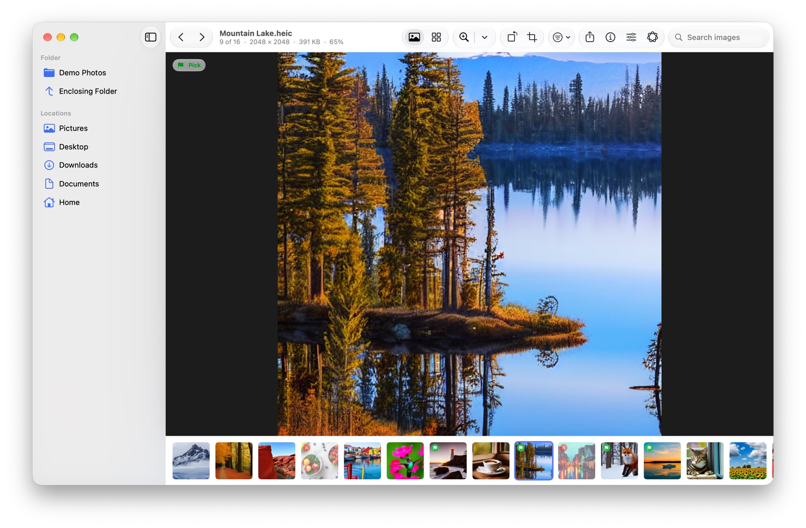
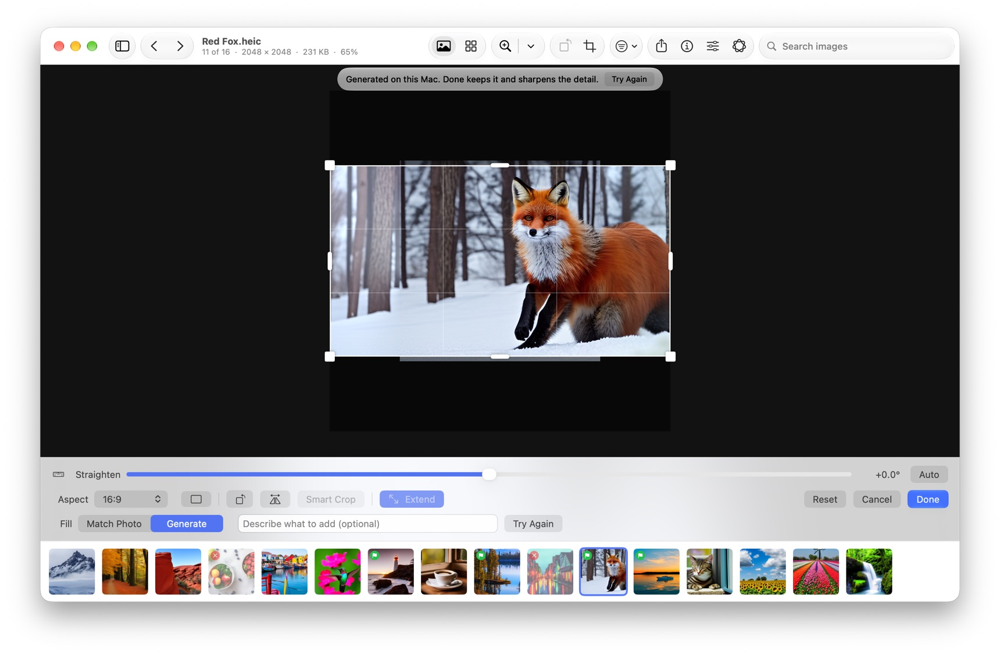
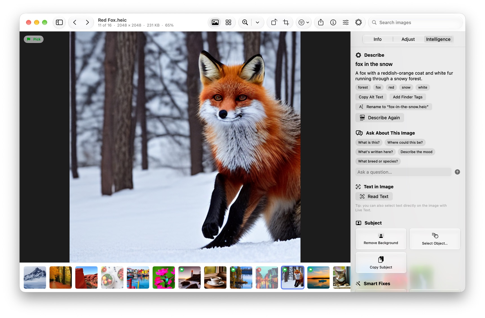
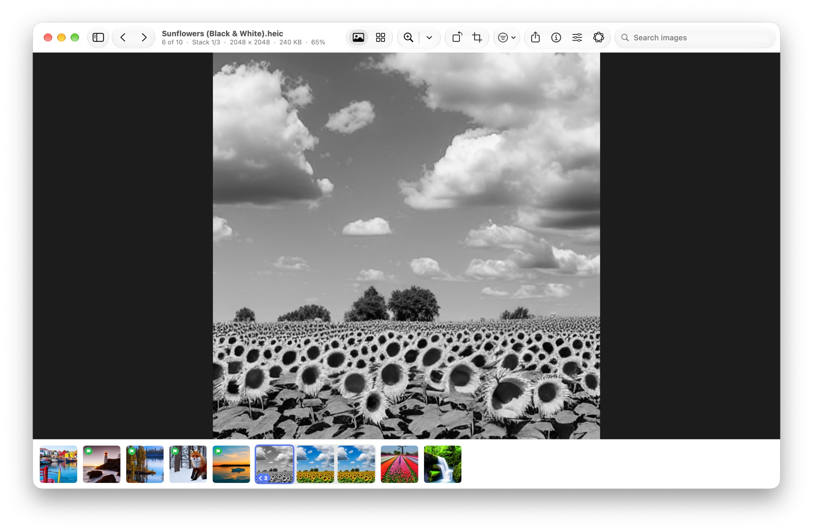
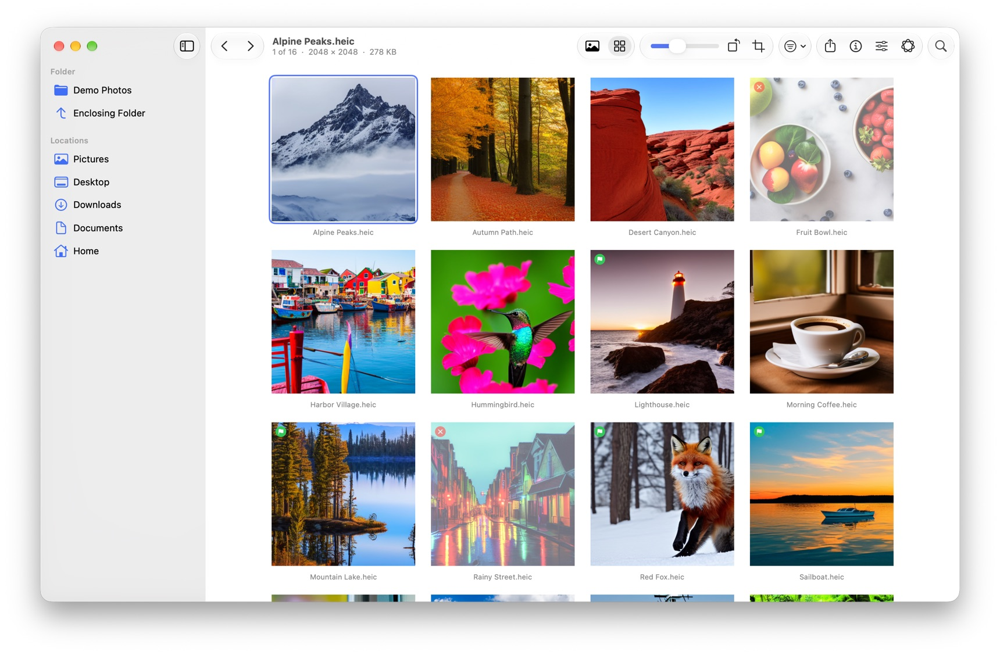

# AOK-ImageTool

A fast, keyboard-first photo viewer and editor for the Mac: browse a folder with the arrow keys, pick the keepers,
edit without touching the original, extend a photo past its edges, remove objects, fix blur, cut out subjects, and use
Apple's on-device intelligence, on files or on your Photos library. Your pictures never leave your Mac.

  <picture>
    <source media="(prefers-color-scheme: dark)" srcset="Screenshots/viewer-dark.jpg">
    
  </picture>

- **Fast browsing.** Arrow keys step through a folder, with the next images decoded ahead of time. Every format macOS
  reads, including HEIC, AVIF, JPEG XL, WebP, 30+ camera RAW formats, PDF and SVG, with HDR shown in HDR.
- **Pick the keepers.** P, X and U pick, reject and unflag (as Finder color labels); filter, sort by Apple's
  judgment of the best shots, find duplicates and similar photos.
- **Edit without fear.** Light, color, detail and filters, crop and straighten (by the degree or tenth of a degree, or
  Auto, which levels the horizon). Nothing touches the file until you Save, every change can be undone, and unsaved
  edits survive quitting.
- **Your Photos library too.** Open photos from Photos (Live Photos stay live), edit them here, and Save sends the edit
  back as a Photos edit you can revert, synced by iCloud Photos. Or use Photos' Image ▸ Edit With, or import photos
  into a folder as ordinary files.
- **Extend a photo** past its edges, to 16:9 or any frame: continue its own texture, or **Generate** new content with
  an image model that runs on your Mac.
- **Fix blur:** take soft focus or camera shake out of a photo, and restore blurry faces, with models that run on
  your Mac.
- **Remove objects:** paint over a passer-by, a sign or a power line, click it or circle it, and it's filled in from
  what's around it, with LaMa (a model made for this) running on your Mac.
- **White balance:** click something that should be white or gray and the color cast is gone; or Auto, or correct
  for the light (indoor lamps, shade, fluorescent).
- **Clone & heal:** ⌥-click clean skin, sky or grass and paint it over a blemish, a wire or a bare patch; Heal
  blends it into the color and light where it goes.
- **Change objects:** click a shirt and say “blue”, or “a red plaid flannel shirt”: colors change in place keeping
  their shading, anything more is painted in by the generative model, on your Mac.
- **Copies that stack.** Black & White (with darkroom filters and toning), Colorize, Fix Blur, Upscale with AI (animated
  GIFs too), Extend, Remove and Change Objects, Clone & Heal, and Reimagine save new copies, stacked with the original
  in the filmstrip so a folder stays tidy. (Settings can have them change the image itself instead.)
- **Paste a picture** (⌘V) from anywhere as a new image in the folder.
- **Apple Intelligence** where your Mac has it: describe a photo (alt text, keywords, a file name), ask about it, search
  a folder by what's in the pictures or the text in them, remove backgrounds and generate new ones.
- **A full guide** inside the app (Help ▸ AOK-ImageTool Guide, ⌘?).

## Screenshots

Extend a square photo to 16:9, with new content generated on this Mac:

  <picture>
    <source media="(prefers-color-scheme: dark)" srcset="Screenshots/extend-dark.jpg">
    
  </picture>

Describe a photo, ask about it, and fix it in one click:

  <picture>
    <source media="(prefers-color-scheme: dark)" srcset="Screenshots/intelligence-dark.jpg">
    
  </picture>

Copies stack with their original; spread a stack out to see them all:

  <picture>
    <source media="(prefers-color-scheme: dark)" srcset="Screenshots/stacks-dark.jpg">
    
  </picture>

The grid, for culling a whole folder:

  <picture>
    <source media="(prefers-color-scheme: dark)" srcset="Screenshots/grid-dark.jpg">
    
  </picture>

The photos in these pictures were generated for this project; none of them shows a real person or place.

## Install

1. [Download AOK-ImageTool](https://github.com/emkey1/AOK-ImageTool/releases/latest/download/AOK-ImageTool.dmg)
   (always the latest version; the [releases page](https://github.com/emkey1/AOK-ImageTool/releases/latest) has the notes).
2. Open it and drag **AOK-ImageTool** to **Applications**.
3. Open AOK-ImageTool and open a folder of pictures (⌘O), or drop pictures on its icon.

Requires macOS 15 (Sequoia) or later on Apple silicon. AOK-ImageTool offers new versions itself
(AOK-ImageTool ▸ Check for Updates…).

**What each macOS can do.** Everything except the following works on macOS 15: Image Playground needs 15.1 and Apple
Intelligence; describing and asking about photos need macOS 26 and Apple Intelligence; Upscale with AI needs macOS 26.
The Guide has the details.

## The optional image models

Two features use image models that run on your Mac but aren't built into the app, because they're large. The app
offers to download each one the first time you use the feature, or you can get them in **Settings ▸ Editing**:

- **Generate** (Extend, and Generate a Background) uses [Stable Diffusion 1.5 Inpainting](https://huggingface.co/stable-diffusion-v1-5/stable-diffusion-inpainting),
  about 2 GB. Its license, [CreativeML Open RAIL-M](https://huggingface.co/spaces/CompVis/stable-diffusion-license),
  limits how the model may be used, so the app asks you to accept it first.
- **Colorize** uses [DDColor](https://github.com/piddnad/DDColor), about 425 MB, under the Apache 2.0 license.

Both are converted to Core ML and hosted on this repository's releases; the app checks each download against a
fingerprint before installing it. See [THIRD-PARTY-NOTICES.md](THIRD-PARTY-NOTICES.md).

## Privacy

Descriptions, questions, search, background removal, upscaling, colorizing and generated fills all run on your Mac.
The app goes online only to download the models when you ask for them and to check for updates (once a day, or
never if you turn it off in Settings).

## Build from source

Requires Xcode 27. Open `ImageViewer.xcodeproj` and press ⌘R. [DEVELOPMENT.md](DEVELOPMENT.md) covers the project
layout, the self-test, how generated fills are made, the models and the release process.

## License

MIT. See [LICENSE](LICENSE). The optional models have their own licenses; see
[THIRD-PARTY-NOTICES.md](THIRD-PARTY-NOTICES.md).

AOK-ImageTool is an independent project and is not affiliated with or endorsed by Apple.
